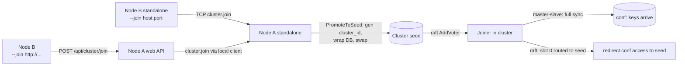

# Godis: Conf Namespace + Standalone-to-Cluster Join — Design

**Date:** 2026-08-12
**Status:** Draft for review
**Scope:** Single deliverable: single-node startup by default; later nodes join via TCP `--join` or HTTP API; the first node shares its configuration through a `conf` namespace in db0 that is synced to joining nodes and propagated between all nodes.

## 1. Goal

- Godis starts **standalone by default** (single node, no flags).
- Later nodes join the cluster via a new `--join <addr>` CLI flag (TCP `host:port` or `http(s)://host:port`), or via the existing HTTP API (`POST /api/cluster/join`).
- The first node is the **seed** and shares all its configuration.
- Configuration is stored as granular keys in the **`conf` namespace of db0**.
- A joining node syncs all data in the `conf` namespace.
- All data under the `conf` namespace is shared/propagated across all nodes.

## 2. Decisions (agreed with user)

| # | Question | Decision |
|---|---|---|
| D1 | Config granularity | Granular keys (`conf:<setting>`), node-local settings excluded |
| D2 | Write authority | Writes accepted anywhere, **forwarded to the seed**; success only after seed applies |
| D3 | Seed promotion | **Auto-promote**: first node starts standalone; a join request hot-switches it to seed |
| D4 | Replication (raft slot mode) | Hybrid: master-slave = full copy on every node via existing sync; raft-slot = single copy, conf keys pinned to slot 0 owned by the seed, non-owner nodes redirect |
| D5 | Deployment topology | Both master-slave and raft-slot must be supported |
| D6 | Addressing model | **Reserved key prefix** `conf:` in db0; no new protocol surface; conf keys filtered from user-facing iteration |

## 3. Kvrocks namespace analysis (source-verified reference)

Researched from `apache/kvrocks` source (unstable, 2026-08-12) and https://kvrocks.apache.org/docs/namespace/.

- A kvrocks namespace is a **key prefix**: `[1-byte len][namespace][key]` prepended in RocksDB (`src/storage/redis_metadata.cc:136-148`, `src/storage/redis_db.cc:530-532`). Not a column family, not a separate DB.
- Per-connection selection via `AUTH <token>` (`src/commands/cmd_server.cc:33-51`) or `SELECT N` mapping db0 → default namespace, dbN → `"dbN"` (`src/commands/cmd_server.cc:133-157`).
- Commands: `NAMESPACE ADD/SET/DEL/GET/CURRENT` (`src/commands/cmd_server.cc:75-106,1790`). Definitions persisted in the config file (`namespace.<name> <token>`), or in the Propagate CF when `repl-namespace-enabled` (`src/server/namespace.cc:175-190`); cannot be disabled once enabled.
- **Cluster mode and namespaces are mutually exclusive in kvrocks** — `NAMESPACE` mutations rejected under `cluster_enabled`; slot migrator hardcodes `kDefaultNamespace` (`src/cluster/slot_migrate.cc:42`).
- Takeaways for godis: prefix scheme is portable; per-namespace auth tokens are baggage (skipped); the namespace/cluster mutual exclusion is a kvrocks workaround, not a necessity — godis supports both.

## 4. Architecture

### 4.1 Conf namespace (storage layer)

- Constant `confNamespacePrefix = "conf:"` in a new `internal/database/namespace.go`.
- Conf keys are ordinary keys in db0's dict named `conf:<setting>`; persistence (AOF/RDB), TTL, and replication machinery apply unchanged.
- **Filtered from user-facing iteration**: `KEYS`, `SCAN`, `DBSIZE`, `RANDOMKEY`, `FLUSHDB`, `FLUSHALL` never see or clear conf keys.
- **Write guard**: client `SET`/`MSET`/`RENAME`/etc. targeting a `conf:` key is rejected with `ERR reserved key prefix "conf:"` unless the write originates from the internal config path (whitelisted executor). One guard in SET-family `prepare()`, zero overhead on read paths.
- Direct reads (`GET conf:x`) are permitted — that is how the engine and operators inspect config.

### 4.2 Config bootstrap and authority

- **Shared vs node-local split (denylist)** — node-local, never stored in the namespace:
  - `server.bind`, `server.port`, `server.dir`, `replication.announce_host`, `replication.slave_announce_port`, `cluster.*` (incl. `cluster_id`, `seed`, `as_seed`, `master_in_cluster`, `join_*`, `raft_*`), `http_api.*`, `web.port`.
- Everything else is shared (`aof.*`, `security.requirepass`, `security.masterauth`, `slowlog.*`, `monitoring.*`, `server.maxclients`, `server.databases`, `azure.*`, …), stored as `conf:<key>` keys.
- **First boot (seed)**: `SetupConfig` writes every shared setting into its `conf:` key after parsing the TOML. The namespace becomes the config representation.
- **Later boots**: if a `conf:` key exists, it wins over the file value. The local file supplies node-local values and first-boot defaults only.
- `CONFIG GET`: read conf key if present, else fall back to in-memory value.
- `CONFIG SET`: update conf key + in-memory value; if not the seed, forward to the seed first (D2).
- `CONFIG REWRITE`: unchanged — writes the effective config (conf keys + local) back to the file.

### 4.3 Join flow (the switch)

- New CLI flag `--join <addr>`:
  - `host:port` → TCP join channel (existing `seed` path).
  - `http(s)://host:port` → HTTP API join (existing `join_http` path).
  - Detection by scheme. Sets the same config fields the file-based `seed`/`join_http` set today, and enables cluster mode (`ClusterEnable=true`).
- Default startup (no `--join`, no `[cluster] enable`) remains standalone.
- **Auto-promotion** (D3):
  - TCP: a standalone node intercepts the `cluster.join` command (today: unknown command) → `PromoteToSeed()` → generate `cluster_id` via existing `WriteBackClusterID`, wrap the live DB with `MakeCluster`, swap via existing `DBSwapper` → then run `execJoin` as raft leader.
  - HTTP: `handleClusterJoin` calls `PromoteToSeed()` when the local node is standalone, before forwarding `cluster.join` to it.
  - Reuses `hotSwitch()` machinery from `internal/cluster/hotswitch.go`; the only new part is the trigger (join request instead of config reload).
- Concurrency: mutex + existing `hotSwitched` flag. Two simultaneous joiners: one wins, the other gets `ERR already in cluster`.
- Backward compatibility: file-driven `seed`/`as_seed`/`join_http` join paths are unchanged.

### 4.4 Data flow per topology (D4, D5)

**Master-slave** (joiners are replicas of the seed):
- Join → slave runs the existing full sync (PSYNC / OSS snapshot) → the entire `conf` namespace arrives with it. This satisfies "join syncs the namespace".
- Ongoing: master→slave replication carries every `conf:` write. No new sync machinery.

**Raft slot mode**:
- Conf keys are pinned to **slot 0**, permanently owned by the seed.
- Slot 0 is marked non-migratable; rebalance plans skip it.
- Non-owner nodes redirect conf reads/writes to the owner through existing slot routing. Single copy; no join-time copy by design.
- Conf writes on a non-owner forward to the seed (D2); seed unreachable → error, no silent local apply.

## 5. Components

| Component | File | Change |
|---|---|---|
| Prefix + helpers | `internal/database/namespace.go` (new) | `confNamespacePrefix`, `isConfKey()`, write guard, iteration filters |
| Bootstrap ↔ conf keys | `internal/config/config.go` | write shared settings on first boot; conf key wins on later boots; shared/local denylist |
| `CONFIG GET/SET/REWRITE` mapping | `internal/database/systemcmd.go` | GET conf-key-first; SET writes conf key + forwards to seed if not seed |
| `PromoteToSeed()` | `internal/cluster/hotswitch.go` | standalone→seed auto-promote, mutex-guarded, idempotent |
| `cluster.join` intercept (standalone) | `internal/database/server.go` | unknown-command hook → `PromoteToSeed()` → cluster `execJoin` |
| `--join` flag | `cmd/godis/main.go` | parse TCP/HTTP, set cluster fields before server start |
| Conf slot pinning | `internal/cluster/core/` | slot 0 non-migratable; redirect via existing routing |
| HTTP join auto-promote | `internal/web/cluster_api.go` | `PromoteToSeed()` when standalone before forwarding |

## 6. Error handling

| Case | Behavior |
|---|---|
| `--join` target already clustered | `ERR already in cluster` (existing `execJoin`) |
| `--join` target unreachable | Clear startup error, nonzero exit; retry = re-run |
| Two joiners race a standalone seed | Mutex + `hotSwitched` guard; loser gets `ERR already in cluster` |
| Client `SET conf:x` | `ERR reserved key prefix "conf:"` |
| `FLUSHDB`/`FLUSHALL` | Conf keys survive (config, not data); logged |
| Conf write on slave / non-owner | Forwarded to seed; seed down → error, no local apply |
| `cluster_id` mismatch | Existing rejection, unchanged |
| Raft mode, seed down | Conf access on other nodes returns existing slot-redirect error |

## 7. Testing

Existing patterns: `MakeTestDB` / `NewStandaloneServer`, ephemeral ports, `internal/redis/protocol/asserts`. No external frameworks.

- **Unit**: conf keys excluded from KEYS/SCAN/DBSIZE/RANDOMKEY/FLUSHDB; `SET conf:x` rejected; bootstrap writes shared keys from TOML fixture; node-local keys never written; `CONFIG GET` prefers conf key over file value.
- **Unit**: `PromoteToSeed()` — standalone swapped to cluster, `cluster_id` generated + written back, second call is a no-op.
- **Integration** (ephemeral ports): TCP `--join` and HTTP join both form a 2-node cluster; joiner sees all seed `conf:` keys after sync; `CONFIG SET` on a non-seed is applied and visible on all nodes (3-node); raft-mode rebalance plan excludes slot 0.
- **Regression**: existing cluster v2 and standalone test suites still pass.

## 8. Out of scope (explicitly not built)

- Per-namespace auth tokens (kvrocks `NAMESPACE ADD <name> <token>` model) — skipped as baggage.
- Multiple namespaces — only `conf` exists; the prefix mechanism generalizes later if needed.
- Nacos-driven shared config — existing Nacos path unchanged; namespace is an additional representation, not a replacement trigger.
- Conflict resolution beyond seed-authority (last-writer-wins) — seed is the single writer by design (D2).
